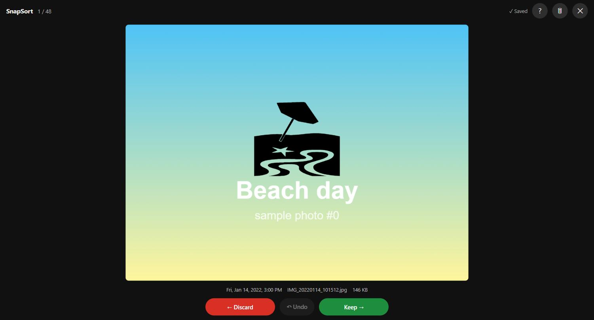
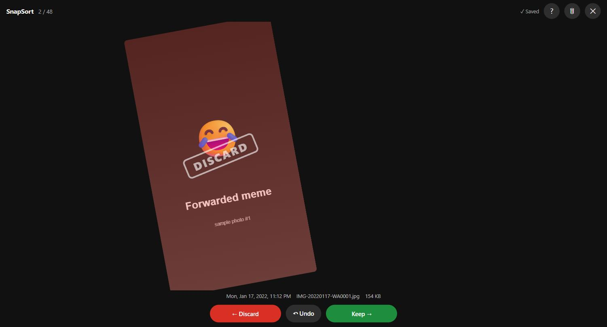
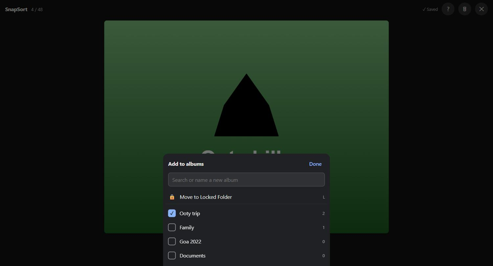
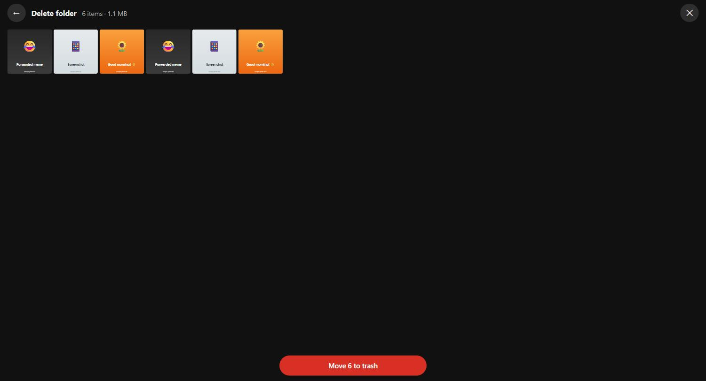

# SnapSort

A browser extension for cleaning up a Google Photos library one photo at a time. Swipe right to keep, swipe left to discard, tap to file a photo into albums or the Locked Folder. Review everything you discarded before any of it goes to trash.

Built for libraries buried under years of WhatsApp forwards, screenshots and memes, where the only reliable filter is you.

<p>
  
  
</p>
<p>
  
  
</p>

*Screenshots use the offline demo's sample pictures.*

## What it does

- **One photo at a time, oldest first.** Photos and videos, with date, filename and file size.
- **Keep or discard.** Swipe or use the arrow keys. Discards go into a real Google Photos album, **🗑 To Delete**, so nothing is deleted yet.
- **Undo** the last swipes with `Z`, including Google Photos changes already sent.
- **Albums.** Tap a photo to add it to any albums, or type a name to create one ("Ooty trip").
- **Locked Folder.** Move a photo there from the same sheet, or press `L`. Undo moves it back.
- **Delete folder.** Look through everything you discarded, rescue anything, then move the rest to Google Photos Trash in one go (restorable for 60 days).
- **Picks up where you left off**, on any device. Your place is saved in a small album in your own Google Photos, so a laptop and a phone share progress.
- **Catches late uploads.** Old photos uploaded after your last session (a restored WhatsApp backup, say) are shown first as "New since last time".
- **Private.** No server. Everything runs in your browser against your own Google Photos session.

| Key | Action |
|---|---|
| `→` / swipe right | Keep |
| `←` / swipe left | Discard to 🗑 To Delete |
| `Z` | Undo |
| `A` / tap photo | Add to albums |
| `L` | Move to Locked Folder |
| `?` | Shortcuts, export / import progress |
| `Esc` | Close |

## Install

SnapSort isn't on the Chrome Web Store. Load it unpacked:

```sh
npm install
npm run build
```

1. Open `brave://extensions` (or `chrome://extensions`) and turn on **Developer mode**.
2. Click **Load unpacked** and choose the `dist/` folder.
3. Open [photos.google.com](https://photos.google.com). A blue **SnapSort** button appears in the bottom-right corner.

The first run indexes your library (about 15 seconds for 6,500 items), then starts at your oldest photo.

**On a phone:** Chrome for Android doesn't support extensions. Brave for Android has experimental support behind `brave://flags/#brave-android-extensions`; phones have no extension toolbar, so use the in-page SnapSort button.

## How it works

Google's official Photos API can no longer read your whole library and has never been able to delete, so SnapSort runs on photos.google.com itself and calls the same internal endpoints the website uses (`/_/PhotosUi/data/batchexecute`), with your existing session.

- A tiny script in the page reads the session token and hands it to the extension's content script.
- The library is indexed into IndexedDB and refreshed incrementally from "Recently added".
- Every change (discard, album, Locked Folder) goes through a saved, retrying queue, so swipes are instant and survive a reload.
- If Google changes its responses, SnapSort stops making changes and says it needs an update instead of guessing.

The internal endpoints are documented in [REQUIREMENTS.md](REQUIREMENTS.md#google-photos-internal-api-verified-in-phase-1).

> [!WARNING]
> This uses undocumented Google Photos endpoints. It isn't affiliated with or endorsed by Google, and it can break when Google changes its website. SnapSort only ever moves photos to Trash; it never empties Trash or deletes permanently.

## Development

Requires Node 20.19+.

```sh
npm run dev        # watch build into dist/
npm run build      # production build into dist/
npm run zip        # build + snapsort-<version>.zip
npm run typecheck && npm run lint && npm test
npm run demo       # offline demo on sample pictures: http://localhost:5179
npm run harness    # dev harness for testing inside a photos.google.com tab
```

After rebuilding, click reload on the SnapSort card in the extensions page, then reload the Google Photos tab.

- **Offline demo:** the real UI with the Google Photos API swapped for [`src/demo/mockApi.ts`](src/demo/mockApi.ts). No account needed.
- **Dev harness:** runs the real code inside a photos.google.com tab without installing the extension. See [IMPLEMENTATION.md](IMPLEMENTATION.md#testing-strategy).

```
src/
├─ api/          Google Photos internal API (the only code that knows Google's formats)
├─ db/           IndexedDB library index and incremental refresh
├─ review/       review session, delete folder, wiring
├─ sync/         write queue, 🗑 To Delete albums, cross-device progress
├─ ui/           Preact components
├─ content/      content script (in-page button, Shadow DOM mount)
├─ main-world/   page script that reads the session token
├─ demo/         offline demo (not shipped)
└─ harness/      dev test harness (not shipped)
```

Built with TypeScript, Preact, esbuild and `idb`; tested with Vitest.

## Docs

- [REQUIREMENTS.md](REQUIREMENTS.md): what SnapSort does and why, plus the verified internal API
- [IMPLEMENTATION.md](IMPLEMENTATION.md): phase plan and status
